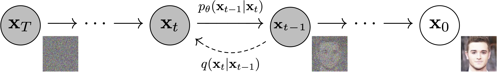
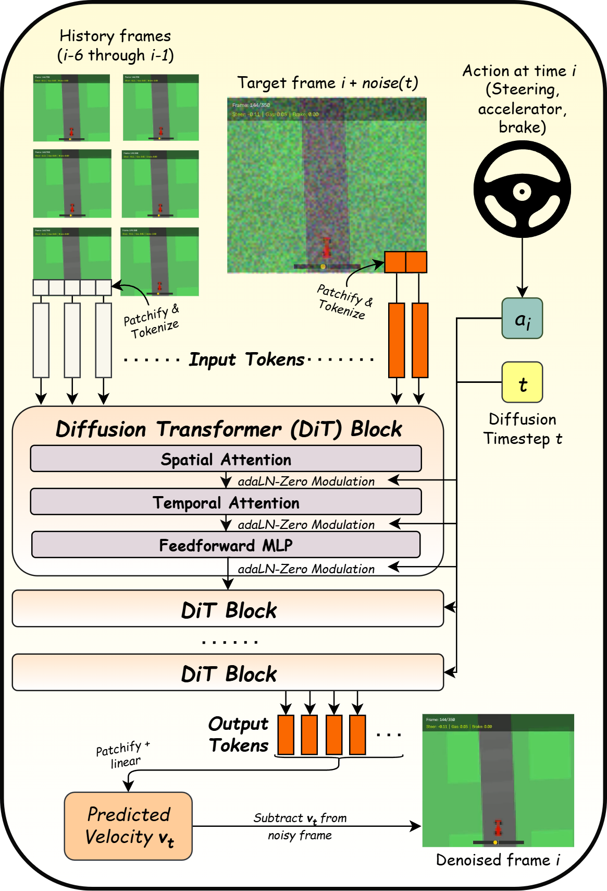
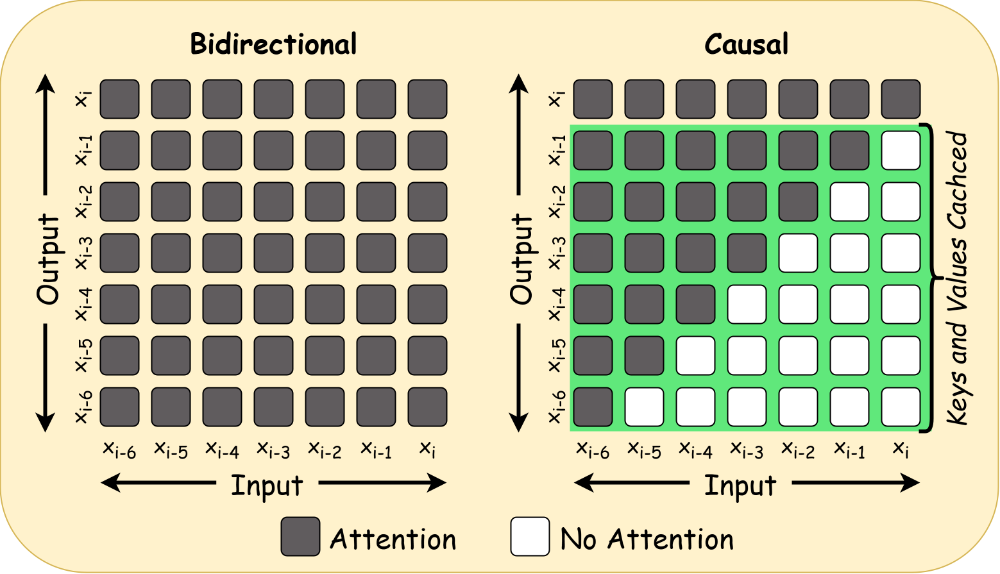

<!-- _paginate: false -->


# Interactive Diffusion Models from Scratch

Liam Schoneveld

<video src="../images/interactive-diffusion-1/drive-diff-model.mp4" poster="../images/interactive-diffusion-1/poster.jpg" autoplay loop muted playsinline style="height:380px; display:block; margin:0 auto;"></video>

<span class="small">Code & checkpoint: github.com/nlml/interactive-diffusion</span>

---

<div class="cols">
<div>

## What are we building?

**Action-conditioned video generation**: a neural net as a game engine (cf. DeepMind's Genie).

At each step:
- **Input:** recent frames + current player controls
- **Output:** the next frame
- Repeat in real time → playable simulator

Goal: a super minimal version of this same concept, trained from scratch.
</div>

<div>
<figure>
  <video src="../genie2.mp4" autoplay loop muted playsinline style="height:320px;"></video>
  <figcaption style="text-align: center;"><em>Deepmind's Genie 3</em></figcaption>
</figure>

</div>
</div>

---

## Data

<div class="cols wide">
<div>

**Source:** Gymnasium `CarRacing-v3`, played by a pretrained PPO agent.

**Scale:** ~30 h of video
- Resolution: 84×96 pixels
- Framerate: 25 fps
- Per-frame actions: $\mathbf{a} = (\text{steer}, \text{gas}, \text{brake})$
- Split into episodes (~10 sec each)

**Processing:** We add noise and smoothing to the agent's actions for diversity.

</div>
<div>
<figure>
  <video src="../images/interactive-diffusion-1/smooth_demo.mp4" poster="../images/interactive-diffusion-1/smooth_demo_poster.jpg" autoplay loop muted playsinline style="height:380px;"></video>
  <figcaption style="text-align: center;"><em>A gameplay episode generated by the RL agent</em></figcaption>
</figure>

</div>
</div>

---

## Diffusion in one slide (flow matching)



- **Forward process (fixed):** interpolate data toward Gaussian noise
  $\;\mathbf{x}_t = (1-t)\,\mathbf{x}_0 + t\,\boldsymbol{\epsilon},\quad t \in [0,1]$
- **Training:** the net learns to predict the *velocity* $\mathbf{v} = \boldsymbol{\epsilon} - \mathbf{x}_0$ from $(\mathbf{x}_t, t)$. It's plain MSE regression.
- **Sampling:** start from pure noise at $t=1$ and integrate back to $t=0$ with a few Euler steps: $\mathbf{x}_{t-\Delta} = \mathbf{x}_t - \Delta\,\hat{\mathbf{v}}$
- Each step is a full forward pass, so **step count drives latency**. We use 4.

---

## Architecture: a pixel-space DiT

<div class="cols">
<div>

- No VAE: at 84×96 we can diffuse directly on pixels
- 4×4 patches → 504 tokens/frame; 7 frames → **3,528 tokens**.
Full attention over all of them is too slow.
- **Factorised spatiotemporal attention** in each block:
  1. *Spatial*: tokens within a frame attend to each other
  2. *Temporal*: tokens at the same (x, y) attend across frames
  3. MLP
- **AdaLN-Zero Modulation**: modulate each layer with (action $a_i$ + diffusion timestep $t$)

</div>
<div style="align-self: start; margin-top: -110px; margin-left: 70px;">



</div>
</div>

---
<!-- 
## Conditioning & training

**Window:** 6 clean context frames (~240 ms) + 1 target frame to generate.

Per-frame conditioning vector, injected via **AdaLN-Zero** into every sublayer:
$$\mathbf{c}_j = \text{MLP}(\text{sinusoid}(t_j)) + \text{MLP}(\mathbf{a}_j)$$
Context frames get $t_j = 0$ (clean); the target gets the sampled $t$.

```python
t = torch.rand(b)
noise = torch.randn_like(target)
# corrupt ONLY the target
target_noisy = (1 - t) * target + t * noise
# (B, 7, C, H, W)
seq = torch.cat([context, target_noisy], dim=1)
timesteps = torch.zeros(b, 7); timesteps[:, -1] = t
pred = model(seq, timesteps, actions)
# velocity on target only
loss = F.mse_loss(pred[:, -1:], noise - target)
```

--- -->

## Speed: causal temporal attention + KV cache

<div class="cols">
<div>

First version: **~2 FPS** on my laptop's RTX 3060.

Lots of redundant computation going on (history KV recomputed every denoising step)

**Fix:** make temporal attention **causal**:
- Context K/V no longer depend on the target: can compute **once** and cache
- At inference time: run only the **target frame** ($T = 1$)
- After denoising steps, push its K/V to the cache and evict the oldest

**Result: ~5× speedup.**

</div>
<div>



</div>
</div>

---

## Problem: autoregressive drift

<div class="cols">
<div>

It plays, but after about a second the track warps and dissolves into mush.

**Exposure bias:**
- *Training:* conditioned on perfect, ground-truth history
- *Inference:* conditioned on its **own** slightly-wrong outputs

Small artifacts compound. Within a few frames the inputs are out of distribution.

</div>
<div>

<video src="../images/interactive-diffusion-1/autoregressive_drift.mp4" poster="../images/interactive-diffusion-1/autoregressive_drift_poster.jpg" autoplay loop muted playsinline style="height:480px;"></video>

</div>
</div>

---

## Fix: context noise augmentation

One option is ***Diffusion Forcing***: give every history frame its own noise level at train *and* inference time. This makes KV-cache management difficult.

A simpler approach is to **add noise to the context during training**:
<p></p>
<div class="cols wide">
<div>

```python
sigma = torch.rand(B, T_ctx, 1, 1, 1) * context_noise_max   # e.g. 0.2
context = (1 - sigma) * context + sigma * torch.randn_like(context)
```
</div>
<div>

$$\sigma_j \sim \mathcal{U}(0, \sigma_{\max})\\
\\
\tilde{\mathbf{x}}_j = (1-\sigma_j)\,\mathbf{x}_j + \sigma_j\,\boldsymbol{\epsilon}_j$$
</div>
</div>
<p></p>

- We still tell the model that context is clean ($t_j = 0$)
- Inference is unchanged
- Gaussian noise isn't the model's real error distribution, but it's a good enough proxy. **Drift disappears.**

---

## Results & what's next

<div class="cols wide">
<div>

**Now:** a playable world model at **~8 FPS** on a laptop GPU (4 Euler steps, ~450 MB of weights).

**Remaining issues & next steps**
1. **Data diversity:** trained only on good driving, the model steers itself toward the track and can't handle braking. Fix: record the RL agent at *all* stages of training (as in GameNGen).
2. **Run in the browser (<50 MB):**
   - Distill to 1–2 steps (reflow / consistency models)
   - Bigger patches, a tiny VAE, or a smaller model
   - fp16 / int8 quantisation

</div>
<div>

<video src="../images/interactive-diffusion-1/drive-diff-model.mp4" poster="../images/interactive-diffusion-1/poster.jpg" autoplay loop muted playsinline style="height:340px;"></video>

<span class="small">github.com/nlml/interactive-diffusion</span>

</div>
</div>
